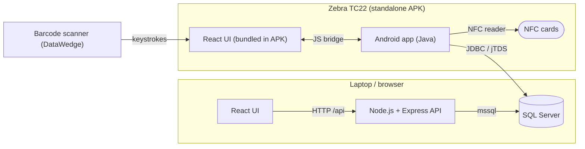

# Refrigerator Cabinet NFC Validation System

A factory-floor application that verifies refrigerator cabinets by scanning a **foaming barcode** and two **NFC cards** (inner and outer), and records only cabinets whose two card values match. It runs as a web app on laptops and as a **standalone Android app** on a Zebra TC22 industrial handheld, using the device's built-in barcode scanner and NFC reader.

> **Repo description (short):** Factory cabinet validation system: scan a foaming barcode plus inner and outer NFC cards, auto-save matched cabinets to SQL Server, and block mismatches. React + Node.js web app and a standalone Android (Zebra TC22) app with native NFC.

---

## Table of contents

1. [Problem and solution](#problem-and-solution)
2. [Key features](#key-features)
3. [How it works](#how-it-works)
4. [Architecture](#architecture)
5. [Tech stack](#tech-stack)
6. [Project structure](#project-structure)
7. [Database](#database)
8. [Validation rules](#validation-rules)
9. [NFC and barcode reading](#nfc-and-barcode-reading)
10. [API reference](#api-reference)
11. [Setup: web version](#setup-web-version)
12. [Setup: standalone Android app](#setup-standalone-android-app)
13. [Security notes](#security-notes)
14. [Known limitations and next steps](#known-limitations-and-next-steps)
15. [What this project demonstrates](#what-this-project-demonstrates)

---

## Problem and solution

Each refrigerator cabinet carries two NFC cards that must hold the **same value**. If the values differ, the cabinet has two different cards and is defective. Checking this by hand is slow and error-prone.

This system lets an operator scan the cabinet once and get an immediate answer:

- **Values match:** the record is saved automatically and a success toast appears.
- **Values differ:** a blocking **NOT MATCHED** popup appears and stays open until the operator closes it. Nothing is saved.

Matched cabinets are stored in SQL Server with the area (`FREEZER_PRE` or `FREEZER_POST`), so each cabinet is verified once per area and the data is available for date-wise reports.

## Key features

- **Strict scan sequence:** Foaming Barcode, then Inner NFC, then Outer NFC. Steps cannot be skipped.
- **Auto-save on match** with a success toast; no manual save step.
- **Blocking "NOT MATCHED" popup** on mismatch. It stays until closed, ignores further scans while open, and cannot be dismissed accidentally by a scanner's Enter key.
- **Same-card protection:** tapping the Inner card again as the Outer card is rejected.
- **Two fixed workstations:** Freezer Pre and Freezer Post.
- **One record per barcode per area**, enforced by a SQL unique constraint (also covers concurrent saves).
- **Retry on failure:** if a save fails (network or database), scanned values are kept and a RETRY SAVE button appears.
- **Double validation:** the same rules run in the UI and again on the server (Node backend or Android app), so the client is never trusted.
- **Native NFC on Android:** the APK reads cards with the TC22's built-in reader; no PC reader program is needed.
- **Standalone APK:** the web UI is bundled in the app and it writes directly to SQL Server. No intermediate server is required on the tablet.
- **Keyboard-wedge friendly:** USB scanners and readers that type into a field also work.
- **Factory-friendly UI:** large inputs, clear status colors, no on-screen keyboard popping up on the handheld, screen kept awake.
- **CI-built APK:** a GitHub Actions workflow builds the web app and the APK automatically.

## How it works

```
Scan Foaming Barcode  ->  Tap Inner NFC  ->  Tap Outer NFC
                                                  |
                                       Inner value == Outer value?
                                        /                       \
                                     YES                         NO
                                      |                           |
                          Save to SQL Server              "NOT MATCHED" popup
                          Success toast                   (stays until Close)
                          Form resets                     Nothing saved, form resets
```

1. The operator picks a workstation (Freezer Pre or Freezer Post).
2. The Foaming Barcode field is focused. The barcode must be `F4` followed by 13 digits.
3. The Inner NFC card is tapped, then the Outer NFC card.
4. When the Outer value arrives, the app compares it with the Inner value and either saves or shows the popup.
5. After a save, the form clears and focus returns to the barcode field for the next cabinet.

## Architecture

The same React UI runs in two modes.



- **Web mode:** React talks to the Express API, which validates and inserts using parameterized SQL.
- **Android mode:** the page is served from the APK's assets inside a WebView. A JavaScript bridge delivers NFC taps to the page and accepts save requests, which the Java layer validates and writes to SQL Server over JDBC. The UI code is the same; only `api.js` and the NFC hook switch behavior when the bridge is present.

## Tech stack

| Layer              | Technology                                                   |
| ------------------ | ------------------------------------------------------------ |
| Frontend           | React 18, Vite, Tailwind CSS, Axios, lucide-react            |
| Backend (web mode) | Node.js, Express, `mssql`                                    |
| Database           | Microsoft SQL Server                                         |
| Android app        | Java, Android WebView, `NfcAdapter` reader mode, jTDS (JDBC) |
| NFC (browser)      | Web NFC API (Chrome on Android, HTTPS only)                  |
| Barcode (handheld) | Zebra DataWedge keystroke output                             |
| Build / CI         | Gradle, GitHub Actions                                       |
| Hardware           | Zebra TC22 (built-in barcode scanner and NFC)                |

## Project structure

```
.
├── .github/workflows/build-apk.yml      # builds the web app and the APK in CI
├── android/                             # standalone Android app
│   └── app/src/main/
│       ├── AndroidManifest.xml
│       └── java/com/factory/cabinetvalidation/MainActivity.java
├── backend/                             # Express API (web mode)
│   └── src/
│       ├── config/db.js                 # SQL Server connection pool
│       ├── controllers/cabinetController.js
│       ├── middleware/errorHandler.js
│       ├── routes/cabinetRoutes.js
│       ├── services/cabinetService.js   # parameterized INSERT, duplicate handling
│       ├── utils/nfc.js                 # NFC value normalization
│       └── server.js                    # API + serves the built web app
├── database/schema.sql                  # dbo.cabinet_nfc_verification
├── frontend/                            # React app
│   └── src/
│       ├── hooks/useNfcReader.js        # native bridge or Web NFC
│       ├── pages/WorkstationPage.jsx    # scan workflow, toast, popup
│       ├── services/api.js              # HTTP save or native save
│       ├── utils/nfc.js
│       └── App.jsx                      # workstation selection
└── .gitignore
```

## Database

Table `dbo.cabinet_nfc_verification` (see `database/schema.sql`):

| Column              | Type            | Notes                                                  |
| ------------------- | --------------- | ------------------------------------------------------ |
| `id`                | BIGINT IDENTITY | Primary key                                            |
| `foaming_barcode`   | VARCHAR(15)     | `F4` + 13 digits                                       |
| `inner_ncf`         | VARCHAR(255)    | Inner NFC value (column name as in the existing table) |
| `outer_nfc`         | VARCHAR(255)    | Outer NFC value                                        |
| `area`              | VARCHAR(20)     | `FREEZER_PRE` or `FREEZER_POST`                        |
| `validation_status` | VARCHAR(20)     | Always `MATCHED` (check constraint)                    |
| `created_at`        | DATETIME2(0)    | Defaults to `SYSDATETIME()`                            |

Constraints enforce the business rules at the database level:

- `UNIQUE (foaming_barcode, area)`: a barcode can be verified once in each area.
- `CHECK (area IN ('FREEZER_PRE', 'FREEZER_POST'))`
- `CHECK (validation_status = 'MATCHED')`: failed validations can never be stored.
- An index on `created_at` supports date-wise reports.

## Validation rules

| Rule                                                                            | Where enforced                                         |
| ------------------------------------------------------------------------------- | ------------------------------------------------------ |
| Barcode matches `^F4\d{13}$` (case-insensitive input, normalized to upper case) | UI, server, Android app                                |
| Scan order: barcode, then Inner, then Outer                                     | UI                                                     |
| Inner and Outer NFC values must be identical (compared after trimming)          | UI, server, Android app, and indirectly the data model |
| Inner and Outer must be two different physical cards                            | UI                                                     |
| Area must be `FREEZER_PRE` or `FREEZER_POST`                                    | UI, server, Android app, database                      |
| One record per barcode per area                                                 | Database unique constraint (HTTP 409 on duplicate)     |

NFC values are the **20-digit serial** stored in the card's NDEF text record. The card's hardware UID is used only to detect the same card being tapped twice; it is not compared or stored.

## NFC and barcode reading

- **Android app (recommended):** `NfcAdapter` reader mode reads the card, extracts the 20-digit serial from the NDEF data, and pushes it to the page through a JavaScript bridge.
- **Chrome on Android:** the Web NFC API reads the same data, but requires an HTTPS page and a one-time permission.
- **Desktop PC readers:** a reader that types into the focused field (keyboard wedge) works with the same input fields.
- **Barcode:** the Zebra DataWedge keystroke output types the barcode into the focused field and sends Enter.

## API reference

### `POST /api/cabinet-scans`

Request:

```json
{
  "foamingBarcode": "F41234567890123",
  "innerNfc": "12345678901234567890",
  "outerNfc": "12345678901234567890",
  "area": "FREEZER_PRE"
}
```

| Status | Meaning                                                                             |
| ------ | ----------------------------------------------------------------------------------- |
| `201`  | Saved                                                                               |
| `400`  | Validation failed (barcode format, missing or mismatching NFC values, invalid area) |
| `409`  | Barcode already verified in this area                                               |
| `500`  | Server or database error                                                            |

Response body: `{ "success": true | false, "message": "..." }`

### `GET /api/health`

Returns API and database connection status.

## Setup: web version

**Prerequisites:** Node.js 20+, SQL Server, and a SQL client such as SQL Server Management Studio.

1. **Create the table:** run `database/schema.sql` in your database.
2. **Backend:**
   ```bash
   cd backend
   npm install
   cp .env.example .env     # set DB_SERVER, DB_DATABASE, DB_USER, DB_PASSWORD, DB_PORT
   npm run dev              # http://localhost:5000
   ```
3. **Frontend (development):**
   ```bash
   cd frontend
   npm install
   npm run dev              # https://localhost:5173, proxies /api to the backend
   ```
4. **Single-server mode:** build the frontend and the backend serves it on port 5000.
   ```bash
   cd frontend && npm run build
   cd ../backend && npm start
   ```

## Setup: standalone Android app

The APK contains the UI and talks to SQL Server directly. No PC server is needed on the tablet.

1. **Prepare SQL Server:** enable TCP/IP and SQL logins, open the port (1433 by default) in the firewall, and make sure the TC22 is on the same network. Create a limited login for the tablets:
   ```sql
   CREATE LOGIN cabinet_app WITH PASSWORD = 'choose-a-strong-password';
   USE CabinetValidation;   -- your database name
   CREATE USER cabinet_app FOR LOGIN cabinet_app;
   GRANT INSERT ON dbo.cabinet_nfc_verification TO cabinet_app;
   ```
2. **Build the APK:** push the repo to GitHub, open **Actions**, run **Build Android APK**, and download `app-debug.apk` from the run's artifacts. (To build locally: build the frontend, copy `frontend/dist` to `android/app/src/main/assets/www`, then run `gradle assembleDebug` in `android/`.)
3. **Install:** copy the APK to the TC22 and open it. Allow installing from the source if prompted. Turn on NFC in Android settings.
4. **Configure:** on first launch the **Database settings** window opens. Enter the server address (or `HOST\INSTANCE`), port, database, and SQL login, then tap **Save & test**.
5. **DataWedge:** create a profile for the package `com.factory.cabinetvalidation` with barcode input enabled for your label type and keystroke output with **Send Enter key**.

## Security notes

- No login system: the app is designed for fixed factory workstations. Restrict network access to the factory LAN.
- The Android app stores database settings, including the SQL password, privately on the device. Use a dedicated SQL login with `INSERT`-only permission on the one table, not an administrator account.
- All SQL uses parameterized queries.
- Debug-signed APK: suitable for internal sideloading; use a release signing key and an MDM for wider rollout.

## Known limitations and next steps

- The Android app uses the jTDS driver, which can fail if the server forces encrypted connections or accepts only TLS 1.2 or newer. A newer driver or a small API service would remove this limitation.
- Real hardware validation is needed for each site: card format (NDEF text with a 20-digit serial), scanner symbology, Wi-Fi coverage, and database access from the handheld.
- Possible improvements: offline queue with later sync, operator ID and audit trail, reporting dashboard, release signing and over-the-air updates, and automated tests.

## What this project demonstrates

- Designing an end-to-end production workflow with strict sequencing, validation, and failure handling.
- Full-stack development: React and Tailwind UI, Node.js and Express API, SQL Server schema with constraints enforcing business rules.
- Hardware integration: NFC (native Android and Web NFC) and barcode scanning on an industrial handheld.
- Android development: WebView hosting, JavaScript-to-native bridge, JDBC database access from the device.
- Defensive design: server-side re-validation, parameterized SQL, unique-constraint duplicate protection, retry without data loss, and a mistake-proof blocking popup.
- DevOps: GitHub Actions pipeline that builds the web app and packages the APK.
